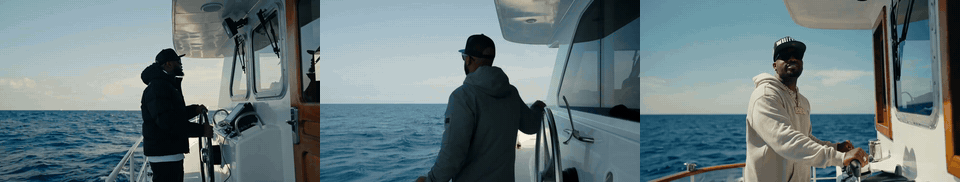
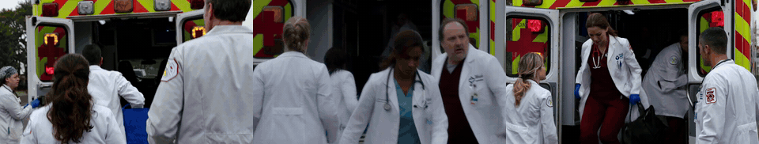

# better_trainer

Built on top of [lightning-hydra-template](https://github.com/ashleve/lightning-hydra-template) for training in complex setups such as distributed training (FSDP2)
and mixed precision of modular models i.e. latent diffusion.

It provides nice features to set up model behavior (frozen / active), add LoRA, compile the model, apply activation checkpointing and shard the model across devices through the Hydra config.

I use this framework to train [Parallel Decoding Distillation](https://arxiv.org/abs/2607.26004) of the [MiniMax-H3](https://github.com/MiniMax-AI/MiniMax-H3) video model as a case study.

- [Base Module Features](#features)


## Case study: PDD distillation of MiniMax-H3

[PDD](https://arxiv.org/abs/2607.26004) (Parallel Decoding Distillation) distills a flow-matching model into a student
that predicts the velocities of several steps in one forward pass. Here it is applied as a LoRA to
MiniMax-H3 (≈33B DiT, text-to-video+audio).

- [](https://huggingface.co/maxsssssss/MiniMax-H3-PDD-LoRA)
- To better see the differences between runs check the [interactive comparison](https://huggingface.co/spaces/maxsssssss/MiniMax-H3-PDD-compare)

<table>
  <tr>
    <th align="center" width="33%">Base, 32 midpoint steps (64 NFE)</th>
    <th align="center" width="33%">Base, 8 NFE</th>
    <th align="center" width="33%">PDD step 2500 EMA, 8 NFE</th>
  </tr>
  <tr>
    <td colspan="3"></td>
  </tr>
  <tr>
    <td colspan="3"><sub>A mid-shot transitioning into an aerial wide shot. Stationary at first, then panning across a vast seascape. The clip starts with a mid-shot of a character dressed in what appears to be dark medieval attire with elaborate detail, emphasizing the high production value. The environment transitions to a vast, open sea during what seems to be either sunrise or sunset, judging by the warm golden hue in the sky and on the water. Dozens of ships with distinct red and black sails are methodically positioned across the seascape, indicating a large fleet. This scene suggests an impending significant event, possibly a battle or journey. The sheer number of ships displays power and organization. The sun's reflection on the calm sea adds a serene yet ominous feel to the scene. A single bird flies above the fleet, perhaps symbolizing freedom or an omen.</sub></td>
  </tr>
  <tr>
    <td colspan="3"></td>
  </tr>
  <tr>
    <td colspan="3"><sub>Guard Duty at the Helm: Transition to the rapper taking a shift at the helm, steering the boat. Use visuals to convey the responsibility and solitude of keeping watch over the vast sea.</sub></td>
  </tr>
  <tr>
    <td colspan="3"></td>
  </tr>
  <tr>
    <td colspan="3"><sub>In the video clip, medical personnel in white coats are seen in a hurried state outside an ambulance marked with a red cross, indicating an emergency or medical crisis situation. The environment suggests urgency; it's chaotic, and the characters are focused on their task. They appear to be at the scene of an incident or preparing to address a critical situation. The color palette is quite muted with whites, grays, and the stark red of the cross on the ambulance standing out. The lighting is natural and overcast, contributing to the grim atmosphere of the scene. The focus on action and response suggests a plot revolving around a medical or disaster-related narrative. Every object and character in motion adds to the tension and gravity of the scene. The camera follows the action, moving quickly and shakily. The shot is a medium close-up in motion.</sub></td>
  </tr>
  <tr>
    <td colspan="3"></td>
  </tr>
  <tr>
    <td colspan="3"><sub>No camera movement, stationary frames, focus shifts between character and paper. Close-up and medium shots, static frames, focused on character. The video features a cartoon character, likely from an animated educational or entertainment content, in a classroom setting. The character, a white figure with minimal detail and a large red circle representing its mouth, is seen holding a piece of paper in the first frame, standing beside a female character with yellow hair, a pink and white striped shirt, expressing disinterest. In subsequent frames, the focus is on the paper with fill-in-the-blank sections titled 'The Best Book Ever,' which the character appears to be excited about, gesticulating joyfully. The paper has blank spaces for students to complete sentences about any book they are reporting on. The environment is simple with plain backgrounds, primarily in white. The colors are flat and cartoonish with bold outlines emphasizing the subjects.</sub></td>
  </tr>
  <tr>
    <td colspan="3"></td>
  </tr>
  <tr>
    <td colspan="3"><sub>Close-up shot of hands and bike parts. Static camera with no visible movement. The clip shows a person's hands performing a bicycle hub conversion. The background is a blurred blue workshop table. The hands, in focus, remove a red 15 by 100 QR axle from its housing. Next to the hands, there's a red bike hub, presumably the Easton M1 referenced in the voice-over. Also visible are a yellow screwdriver and other out-of-focus tools. The removed axle is black with a metallic sheen and threaded at one end. The person's actions are methodical and precise, indicative of experience with the task. The workshop lighting is bright and even, highlighting the components without harsh shadows, emphasizing the tutorial nature of the video. The overall color scheme is dominated by the blue of the work surface and the red of the bike hub.</sub></td>
  </tr>
  <tr>
    <td colspan="3"></td>
  </tr>
  <tr>
    <td colspan="3"><sub>A suspenseful Christmas mystery where a detective uncovers a series of cryptic messages that lead to a long-lost treasure, weaving a tale of intrigue and holiday cheer, candlelit rooms, 4K,</sub></td>
  </tr>
</table>

## Quick start

```bash
conda env create -f environment.yaml
conda activate better_trainer
uv pip install -r requirements.txt
hf download maxsssssss/MiniMax-H3-PDD-LoRA --local-dir pdd_lora
```
### Train

```bash
# 1. cache prompt embeddings
torchrun --nproc_per_node 8 scripts/compute_text_emb_h3.py --model <MiniMax-H3 path> \
    --prompts pdd_lora/data/train.json --output data/h3_cache/train
# 2. train
DIFFUSERS_ATTN_BACKEND=_native_cudnn python src/train.py experiment=pdd_h3 paths.h3_model_dir=<MiniMax-H3 path> \
    paths.prompt_cache_train=data/h3_cache/train/index.json
```

### Inference

```bash
torchrun --nproc_per_node 8 scripts/compute_text_emb_h3.py --model <MiniMax-H3 path> \
    --prompts pdd_lora/data/test.json --output data/h3_cache/test
torchrun --nproc_per_node 8 scripts/pdd_test.py --model <MiniMax-H3 path> --prompt-cache data/h3_cache/test/index.json \
    --output data/test_samples --lora pdd_lora --block-size 4 8 --num-prompts 10
```

### Training setup

- **PDD:** teacher trajectories = 32 steps, min_block_size = 4, max_block_size = 8, i.e. 4-8 NFE at inference. Midpoint solver for teacher target.
- **Student:** frozen bf16 backbone + LoRA + MultiStepHeads: the
  video and audio output projections are replaced by 32 linear layers.
- **Shapes:** 124 frames × 768 × 1344, t2va layout.
- **Optimization:** AdamW, LoRA: lr 1e-4, heads: lr 1e-5, EMA. One trajectory per rank (on 4 GPUs), with `accumulate_grad_batches` = N / min_block_size.


### Data construction

PDD has a data-free algorithm, so only prompts are needed for training, not videos. The prompt dataset is constructed from [Vript](https://huggingface.co/datasets/Mutonix/Vript), [VidProM](https://huggingface.co/datasets/WenhaoWang/VidProM) and [OpenVid-1M](https://huggingface.co/datasets/nkp37/OpenVid-1M), to mix human prompts used to generate videos with machine generated captions. The dataset is filtered mostly by prompt length (> 10 words) and corresponding video length (≈ 5 ± 2 s). I underestimated the training time for this model, so `train.json` contains ~450k prompts, while the model saw only 10k of them 🙂


### Training optimization

- **Only the DiT is used.** No text encoder (cached embeddings) and no VAE (data-free training).
- **On-device sharded loading.** The model is built on `meta`, sharded with FSDP2, and each rank reads
  only its rows of the weights.
- **Mixed precision.** Frozen backbone in bf16; LoRA and heads in fp32 (master weights);
  bf16 all-gather, fp32 gradient reduction. Layers that base model keeps in fp32 get their own FSDP unit without parameter casting. The PDD trajectory state is kept in fp32.
- **Activation checkpointing** on every `MiniMaxH3TransformerBlock`.
- **One model for student and teacher**, switched by disabling LoRA and the MultiStepHeads.
- **Compiled blocks.** `MiniMaxH3TransformerBlock` and `MiniMaxH3TokenRefinerBlock` are compiled with full graph.
- **Efficient attention.** The diffusers implementation of MiniMax H3 is used, so [set](https://huggingface.co/docs/diffusers/main/optimization/attention_backends#available-backends) `DIFFUSERS_ATTN_BACKEND=_native_cudnn` on H100 GPUs.


### Results
The model was trained for 2500 optimizer steps on 4 H100 GPUs (8 days of compute), one trajectory per device, so 10k unique trajectories (prompts) in total. Each trajectory is split into 32 / L_min = 8 blocks, and the gradient accumulation step = 8, i.e. one optimizer step per full trajectory.

After 2500 steps the 8 NFE student visually matches the quality of the 64 NFE teacher. For the same seed the global view
(composition, camera, layout) may differ from the teacher's video, which is expected for PDD: the student is not trained to reproduce the teacher's sample for
a given noise, only to follow a valid trajectory.


#### Domain adaptation
The prompt pool contains human written prompts from the early era of image/video
  generation, with tags for style, position and so on, on which the base model works poorly in terms of prompt understanding (see the examples below).
  The distilled model shows better prompt understanding, which at first glance looks strange, since training
  contains no ground truth videos for these prompts. 
  
  I have a hypothesis for this effect: consider a concept K that is rare in the teacher's training data: the
  base model knows it but generates it unreliably. If the distillation prompts lack K, the student is expected to
  forget it; on the other hand, if, in the limit, the training prompts contain only K, the student can become more reliable than the teacher. In PDD the teacher never generates samples of its own: it only gives the velocity at states of the student's trajectory, so its
  local knowledge is used while its own global errors may be avoided, and averaging across trajectories may cancel out its
  failures while the consistent structure of K adds up. 
  
  The same applies to the prompt writing style S:
  the student learns no new world knowledge, it learns to express the teacher's knowledge for style S, i.e. a form
  of domain adaptation. This suggests a practical use: fix rules for prompt construction and adapt the model to such
  standardized prompts without target videos. However, with further training the student matches the teacher's outputs more closely,
  including its prompt misunderstandings, so this effect may not be stable.


<table>
  <tr>
    <th align="center" width="25%">Base, 32 midpoint steps (64 NFE)</th>
    <th align="center" width="25%">PDD step 1800, 8 NFE</th>
    <th align="center" width="25%">PDD step 2500, 8 NFE</th>
    <th align="center" width="25%">PDD step 2500 EMA, 8 NFE</th>
  </tr>
  <tr>
    <td colspan="4"></td>
  </tr>
  <tr>
    <td colspan="4"><sub>Floating Elegance: "An ethereal, softly glowing script that appears to float over a serene, blurred waterscape, with gentle ripples distorting the reflection of the text -w 2 Message: yandex (Font: COMICS)</sub></td>
  </tr>
  <tr>
    <td colspan="4"></td>
  </tr>
  <tr>
    <td colspan="4"><sub>The talk of a beautiful princess spreading throughout the Middle East.hyper-realistic, &amp;, ultra hd, Pixar style, Disney style. cinema 4d-32</sub></td>
  </tr>
</table>

#### EMA
EMA results are better, most probably because of relatively short training and the small batch size, the authors of the paper mention that a bigger batch size is one of the most important hyperparameters. As can be seen from the [examples](https://huggingface.co/spaces/maxsssssss/MiniMax-H3-PDD-compare), the non-EMA weights produce more blurry, less sharp results, while the EMA weights are much cleaner, although they change the global view of the teacher shot more.

## Features

### 
The main function of `src/models/module/base_module.BaseModule` is to set up network behavior through the config, i.e. frozen / active params, train / eval mode, param dtypes, optimizer configuration, and optionally torch.compile / activation checkpointing. This follows the paradigm that every nn.Module should be added explicitly from the config. This provides the following main features, which can easily be enabled from the config:
- **[torchtitan](https://github.com/pytorch/torchtitan)-style per-block wrapping.** Activation checkpointing → torch.compile →
  FSDP2 sharding are applied per block class (such as TransformerBlock). The order follows the torchtitan logic for efficient utilization.
- **Light checkpoints.** The module tracks active vs frozen state-dict keys. By default frozen weights are dropped from checkpoints (only LoRA, heads and optimizer state are saved).
- **Explicit dtypes for frozen / active parameters.** Although PyTorch Lightning has built-in mixed precision training, it may be useful to explicitly cast the dtype of frozen / active params through the config, to make sure that the optimizer state is in the expected dtype (mainly fp32).
- **Optimizer parameter groups.** Set up param groups with custom lr, weight_decay, etc., for example weight_decay=0 for biases in linear layers.
- **Gradient clip warm-down.** Decays the gradient clip norm linearly from max to base.
- **FSDPMixin.** Nets are built and set up on the `meta` device, then sharded with [FSDP2](https://docs.pytorch.org/tutorials/intermediate/FSDP_tutorial.html) over the data-parallel mesh.
- **EMA callback.** EMA of the trainable parameters is stored in the optimizer state, so it is sharded and checkpointed with the
optimizer.

A net is declared in the model config, for example a LoRA on a frozen bf16 backbone, compiled, sharded and checkpointed per
block:

```yaml
net_configs:
  _target_: src.schemas.fsdp_schemas.FSDPNetConfigs
  transformer:
    init_fn: src.models.net.minimax_h3.build_meta_transformer
    eval_mode: false
    grad: false
    lora_config: {r: 64, lora_alpha: 64, target_modules: [to_q, to_k, to_v, to_out.0]}
    fsdp:
      shard_modules: [diffusers.models.transformers.transformer_minimax_h3.MiniMaxH3TransformerBlock]
      mp_policy: {param_dtype: bfloat16, reduce_dtype: float32}
    activation_checkpointing:
      ac_modules: [diffusers.models.transformers.transformer_minimax_h3.MiniMaxH3TransformerBlock]
    dtype_config: {cast_dtype: true, active_dtype: float32, frozen_dtype: null}
    compile_config:
      compile: true
      compile_modules: [diffusers.models.transformers.transformer_minimax_h3.MiniMaxH3TransformerBlock]
      fullgraph: true
      mode: default
      dynamic: null
```


## Acknowledgements

- [lightning-hydra-template](https://github.com/ashleve/lightning-hydra-template): the project template this repo is built on.
- [PyTorch Lightning tensor parallel example](https://github.com/Lightning-AI/pytorch-lightning/blob/master/examples/pytorch/tensor_parallel/train.py): reference for FSDP2  in Lightning.
- [awesome-minimax-h3-integration](https://github.com/MiniMax-AI/awesome-minimax-h3-integration)
- [MiniMax-H3-FineTuning](https://github.com/IAmIronMan42/MiniMax-H3-FineTuning)
- [VideoX-Fun](https://github.com/aigc-apps/VideoX-Fun): reference of PDD training
- [awesome-text-to-video](https://github.com/jianzhnie/awesome-text-to-video#datasets--benchmarks)
